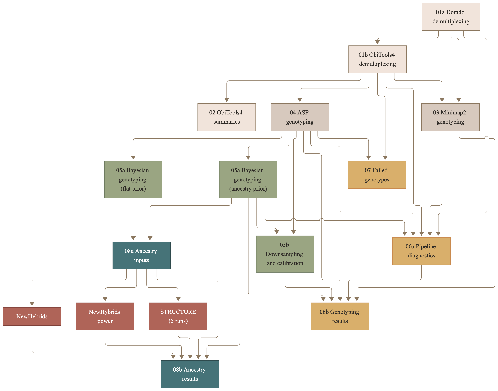

## README

<a rel="license" href="http://creativecommons.org/licenses/by/4.0/"></a><br />This work is licensed under a <a rel="license" 
href="http://creativecommons.org/licenses/by/4.0/">Creative Commons Attribution 4.0 International License</a>.

## Repository for Nanopore SNP Genotyper project and ancestry analysis using simulated data of wolves and wolf-dog hybrids.

This project was made for processing raw Oxford Nanopore ligated amplicon reads and producing SNP genotypes for wolf ancestry analysis. It was built first on simulated data for two differently sized data sets ("small" and "big") with a 33-locus SNP panel from Harmoinen et al. (2021). First edition was built completely in R using several different processing stages controlled from one main .Rmd, now it can also be used with the Snakemake pipeline. It takes simulated Oxford Nanopore reads which contain ligated amplicons in differently sized concatemers, applies dual demultiplexing. First using ONT Native barcodes for sample separation wih Dorado, second demultiplexing is performed with ObiTools4 demultiplexing software with custom NGSFilter file, which separates it further into loci using locus specific STA and LSP primers. Those amplicons are then aligned with allele specific ASP primers and based on the successful or less successful alignment scoring with Biostrings `pairwiseAlignment()` it chooses the winning primer (allele). Those raw votes are then used further with a custom genotyping function with several filters applied on different stages to get cleanest possible usable reads. Those final voting reads are used for genotyping with a naive function (simple custom minimal HT threshold, 0.2) or hierarchical Bayes model with different priors and settings. Some stages produce pipeline production and optimisation specific visualisations, other produce concrete genotyping results, heatmaps and ancestry analysis plots.

## Input files prepared by hand

These inputs must exist inside designated folder before running the pipeline.

-   **Basecalled reads**, one .fastq (preferred) or .bam file per dataset inside `Data/Raw_data/<dataset_name>/` for example `Data/Raw_data/big/basecalled.fastq`. Pipeline does the demultiplexing only, reads must be basecalled before with MinKNOW or dorado basecaller
-   **Barcoding kit** is set in `kit_name` for example: `SQK-NBD114-24`
-   **Barcode map file** must be inside and named `Data/Supporting_data/Samples_ONT_barcodes.tsv`. Its a tab separated linking every Nanopore barcode with a sample (one row per barcode and dataset). It can hold link for different datasets, headers must match. Replicates of the same animal must get a `.r1` ending (only last ancestry analysis stage uses this property for checking if ancestry matches) For example:

```         
dataset  barcode sample_id
big  NB01    W211213
big  NB02    W211224
small NB03 W211225
```

-   **NGSFilter file** must be placed inside `Data/Supporting_data/NGSfilter_file/ngsfilter.csv`. Instructions on how to create it can be found inside ObiTools4 documentation.
-   **Primer panel data** inside `Data/Supporting_data/Primer_panels/...xlsx`, its obtained from Harmoinen et al. 2021, filtered for my 33 loci. It contains SNP names, the two alleles (`SNP name`, `Allele 1`, `Allele 2`), ASP and STA primers and the allele frequency columns (`FreqWOLF_all`, `FreqWOLF_EastEurope`, `FreqWOLF_IT`, `FreqWOLF_IB`, `FreqDOG`) used by priors.
-   **SNP reference sequences** from CanFam3 (`reference_path`, `Data/Supporting_data/Genome_reference_data/snps_500bp_sequences.fa`). It contains FASTA with 1000bp sequence around every SNP locus, with SNP position set at 500.
-   **Reference genotypes** were obtained from the lab, those are known genotypes of tested samples used to evaluate the results of the pipeline. Its a tab separated file with column `sample_id`, `locus`, `genotype` (example: `CT`)
-   **Reference populations** were obtained from Dryad from Harmoinen et al. (2021) research paper, PLINK `.ped` and `.map` files of the reference wolves and dogs

## Pipeline overview



| Stage | Rmd | What it does |
|----|----|----|
| 01a | `01a_Dorado_Demultiplexing.Rmd` | First demultiplexing of Nanopore reads with Nanopore barcoding kit using official Dorado software (separates into samples) |
| 01b | `01b_ObiTools4_Demultiplexing.Rmd` | Second demultiplexing with NGSfilter file using locus specific STA and LSP primer from Harmoinen et al. (2021) primer panel with ObiTools4 obimultiplex (identifies loci) |
| 02 | `02_ObiTools4_Basic_Visualisation.Rmd` | Basic read counts and summaries from second demultiplexing using ObiTools4 official commands |
| 03 | `03_SNP_Genotyping_MiniMap2.Rmd` | Maps amplicon reads to the SNP reference sequences with Minimap2 and calls genotypes from thepileup. It also creates padded reads. |
| 04 | `04_SNP_Genotyping_ASP_primer.Rmd` | Allele-specific primer (ASP) alignment of every read and genotype calling by read votes |
| 05a | `05a_SNP_Bayesian_Genotyping.Rmd` | Hierarchical Bayesian genotyping with RStan. It should be run twice, once with the ancestry prior (wolf ancestry per sample) and with a flat prior (genotypes for stage 08) |
| 05b | `05b_Downsampling_Calibration.Rmd` | Downsampling of read depth and calibration for genotype confidence (GQ) plots |
| 06a | `06a_Pipeline_Diagnostics.Rmd` | Plots and research throughout the pipeline creation process, filtration and per-locus diagnostics visualized |
| 06b | `06b_Genotyping_Results.Rmd` | Genotyping results from all methods compared with the reference genotypes with Stan, downsampling and genotype calibration plots |
| 06c | `06c_Speed_Optimisation.Rmd` | Speed optimization analysis throughout the pipeline creation process |
| 07 | `07_Failed_Genotypes_Analysis.Rmd` | Plots of every amplicon ASP alignment from miscalled samples used for problem diagnosis |
| 08a | `08a_Ancestry_Inputs.Rmd` | Data preparation of reference animals, simulated hybrids, wolf frequency fit and the NewHybrids and STRUCTURE input files |
| 08b | `08b_Ancestry_Results.Rmd` | PCA, DAPC, NewHybrids, NewHybrids power analysis, STRUCTURE and the combined ancestry table |

## Requirements

Software versions used:

| Software | Version | Notes |
|----|----|----|
| **Snakemake** | 9.27.1 | installed in a conda environment (Miniforge) |
| **R** | 4.5.2 | with the packages below, and pandoc for rendering |
| **dorado** | 2.1.1 (build d66c17c6) | Oxford Nanopore basecaller and demultiplexer |
| **ObiTools4** | 4.5.0 |  |
| **minimap2** | 2.31-r1302 |  |
| **samtools** | 1.23 |  |
| **STRUCTURE** | 2.3.4 | command-line version |
| **NewHybrids** |  | command-line version, ([eriqande/newhybrids](https://github.com/eriqande/newhybrids) |
| **graphviz, snakefmt** |  | are optional for rule graph picture and Snakefile formatting |

**R packages**: rmarkdown, knitr, yaml, dplyr, tidyr, readr, readxl, ggplot2, patchwork, scales, Biostrings, pwalign, rstan, adegenet, lme4. The exact package versions of each run are listed in the "Session info" section at the end of every HTML report.

The paths to dorado, ObiTools4, minimap2 and samtools are set in `config/config.yaml`, the paths to NewHybrids and STRUCTURE in `workflow_settings`.

## Folder structure

```         
Full_workflow/
├── Snakefile                  Pipeline: all rules and file paths
├── config/
│   ├── config.yaml            All settings
│   ├── config.schema.yaml     Checks config.yaml settings before every run
│   └── README.md              Description of every setting
├── profiles/default/
│   └── config.yaml            Snakemake run options
├── Code/
│   ├── Rmd_Stages/            Stage Rmds
│   ├── R_scripts/             Render_stage.R, asp_functions.R (shared functions)
│   └── HTMLs/                 HTML reports
│   ├── Stan/                  Stan model
├── Data/                      Raw reads, processed reads and supporting files
├── Results/                   Genotype tables and graphics
├── logs/                      One log per job
└── benchmarks/                Run time per job
```

## Running the pipeline

All commands are run from the `Full_workflow` folder inside a terminal with Snakemake environment:

| Task | Command |
|----|----|
| Dry run, shows what would run without actually running | `snakemake -n` |
| Runs everthing that is missing or out of date | `snakemake --cores 4` |
| Runs one stage (and anything before it its out of date) | `snakemake --cores 4 stage_07_failed_genotypes` |
| Runs the speed optimization visualization (06c) | `snakemake --cores 4 Code/HTMLs/06c_Speed_Optimisation.html` |
| Reruns a stage even if it is up to date | `snakemake --cores 4 --forcerun stage_06b_results` |
| Continues after an interrupted run | `snakemake --cores 4 --rerun-incomplete` |
| Unlocks the folder after a crash | `snakemake --unlock` |
| Marks existing results as up to date without running | `snakemake --touch --cores 1` |
| Checks the Snakefile for possible code standardisation | `snakemake --lint` and `snakefmt --check Snakefile` |

Rule names for single stages are `stage_01a_dorado`, `stage_01b_obitools`, `stage_02_obitools_summaries`, `stage_03_minimap2`, `stage_04_asp_genotyping`, `stage_05a_bayesian`, `stage_05a_bayesian_genotype_prior`, `stage_05b_downsampling`, `stage_06a_diagnostics`, `stage_06b_results`, `stage_06c_speed`, `stage_07_failed_genotypes`, `stage_08a_ancestry_inputs` and `stage_08b_ancestry_results`.

## How settings and reruns work

-   All the settings are in `config/config.yaml` and described in `config/README.md`. Snakemake checks the file against `config/config.schema.yaml` first, so any misspelled setting or a wrong value stops the run with a message.
-   Each stage Rmd declares the settings it uses in its YAML header, then `render_stage.R` passes only those stage specific settings to the Rmd. Snakemake reruns a stage only when setting fo specific stage, its inputs or its code is changed. Every later stage which depends on those results is also rerun.
-   Result folders are named after the settings that produce them (built by `build_run_names()` in `asp_functions.R` script), so runs with different settings never overwrite each other. This holds for genotype results and Stan/Downsampling results where setting options are endless.
-   Stage 08 uses genotypes from a second Bayes run with a flat (1/3) prior with no assumptions, so the different independent ancestry analysis tools dont use genotypes whose results were obtained with using ancestry priors. This specific flat priorrun has its own rule and its own report (`05a_SNP_Bayesian_Genotyping_flat.html`).

## Outputs

-   all HTMl report are found inside `Code/HTMLs` and contain code, kable wist results and sometimes plots
-   all genotypes results ans tables are found inside `Results/<dataset>/Genotypes_results/` (Minimap2, ASP and Bayes folders)
-   all graphics and deep dive analysis tables are found inside `Results/<dataset>/Graphics/`
-   logs and run times are found in `logs/` and `benchmarks/`. Some Rmd stages also produce its own timing summary files, every log also contains the results from the `/usr/bin/time -l` command, because benchmark doesnt work in some cases.

## Notes

-   NewHybrids and STRUCTURE use are marked as heavy jobs inside snakemake, also saved inside `profiles/default/config.yaml`. That setting makes it run one at a time. If you have the means to run them in parallel use `--resources heavy_jobs=4`.
-   A full run takes around 1 to 2 hours with 24 samples. Practically most of that time goes to NewHybrids power analysis (about 1 hour) and STRUCTURE. Some of it to Stan as well, but its still not that CPU intensive as last two tools.

## Reference

Harmoinen J., von Thaden A., Aspi J., et al. (2021). Reliable wolf-dog hybrid detection in Europe using a reduced SNP panel developed for non-invasively collected samples. *BMC Genomics* 22, 473.
